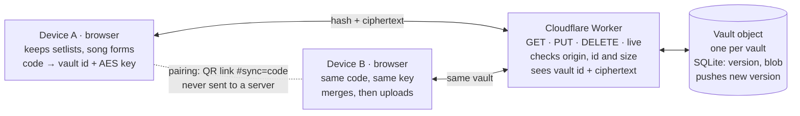

# Device sync — plan & WBS

As of 2026-11-13. Status: everything except the band's approval of the privacy wording and the real-device checks is built (milestones 1–4; the Playwright test passes in Chromium as of 2026-11-13; the WebKit run, which only CI does, hasn't been checked). Hostname: `rj-sync.redjackets.workers.dev` (decided; a custom domain can come later) (`SYNC_URL` in `lib/sync/engine.js`, `ALLOWED_ORIGINS` in `workers/sync/wrangler.toml`).

**Built:** WBS 1 (the Cloudflare account, workers.dev subdomain and deploy secrets), 2.1–2.7 (`workers/sync/`, tested with fake Durable Objects; the live endpoint's upgrade path and `wrangler deploy` itself are untested here), 3 (`lib/sync/crypto.js`), 4.1–4.6 (`lib/sync/clock.js`, stamping in `setlists-store.js` and `songs/sheet/song-form.js`, change detection in `lib/sync/doc.js`), 5 (`lib/sync/merge.js`, `validate.js`, `doc.js`), 6.1–6.8 (`lib/sync/engine.js`, `lease.js`, `changes.js`, `live.js`; `songs/sync/sync.js`; no `sync` store slice, the feature keeps its own status), 7.1–7.5 (`#syncModal`, the `#sync=` link, the QR with the vendored `qrcode-generator`, focus and live status), 8.1–8.4 (real nl/de/fr strings, not yet reviewed by a native speaker; the tour step `setlists/sync`; CLAUDE.md), 8.5 (privacy page `content/privacy.{en,nl,de,fr}.md` and the footer link; wording still to be approved by the band), 9.1–9.2 (the `deploy-sync` job and its curl smoke step), 10.1 (`tests/e2e/sync.spec.js`, both tests pass in Chromium; the two-device test is skipped on WebKit) and 10.2 as a jsdom test.

**Phase 2 progress (2026-11-13):** the engine is now `createVaultEngine` with a *codec* (`PERSONAL_CODEC`, `BAND_CODEC`), so the band space reuses the same server, encryption, conflict retries and push channel. `lib/sync/band-vault.js` (tested end to end against a fake server) holds the band document — members with display names, and song-form versions per song and author, with tombstones, validation and a symmetric merge — plus the local profile (`rj.band.profile`: author id and name), the share switches (`rj.band.shared`) and the cached merged document (`rj.band.doc`, where bandmates' versions are read from: `versionsOf`). Done: 11.1–11.3 — a "Band space" section at the foot of the Connect devices dialog (name, start/join with a code, sync now, leave, delete server copy; `songs/sync/band.js`, feature `band`, syncs on load, page shown, online and 3 s after an edit; no push channel or tab lease yet, with its own QR and a `#band=<code>` share link: Share…, WhatsApp, Email, Copy link), and in the song-form menu bandmates' versions (shown plain, read-only), "Copy to my version" and a "Share with the band" switch (`songs/sheet/song-form.js`), in four languages. **Shared setlists (11.4, built 2026-11-14, in a changed form):** each space has its own *Shared shelf* on the Setlists tab, titled with the space's name (e.g. "My Band"), ending in its own "New setlist" button — the same dialog as a personal setlist (Empty, Remix, Upload), created *in that space*; Remix can also start from a shared setlist. The plan's "move a personal setlist into the space" is not built: a setlist is born in a space and stays there, so there is no share switch and no 11.5 yet. Everyone in the space can edit and delete one. The band document gained `setlists` and `tomb.setlists`/`tomb.rows` (`BAND_FORMAT` 2; a format-1 document still reads, an older app copy downloads only) and merges with the personal vault's own `mergeSetlists`. Locally a space's setlists sit under `rj.band.<id>.setlists` with their tombstones and stamp clock in `rj.band.<id>.meta`; `bandSetlistStorage()` is a storage view that redirects those two keys, so every `setlists-store.js` function, and the whole open-setlist view and "Add to setlist" tray, edit a shared setlist unchanged (`songs/setlists/scope.js`'s `setlistStorage(ctx)` picks the storage by the nav slice's new `currentBandId`). A `#sl=<id>` link finds a shared setlist too. Leaving a space (or its server copy being deleted) keeps its setlists as personal ones; opening the Setlists tab pulls the spaces if stale. Four languages (not reviewed by a native speaker); unit tests for the vault (two members' concurrent edits, rename, delete, validation, per-space and leave), home, modal, navigation and view. Not done: the "edited by Anna" label, a share/unshare switch for existing personal setlists and moving between vaults (11.5), the tour step and the two-member e2e test (11.6), push to open screens. Decisions taken for now: one band space per device; a member's two devices are two authors (the author id is per device); the 64 KB cap is unchanged (raise it only when real sizes ask for it).

**Not done:** the band's approval of the privacy wording, 10.3 (a pass on the old iPad and a current phone), `wrangler secret put SALT_SECRET` (after the first deploy), merging to `master` so `deploy-sync` runs, and a native-speaker review of the translations.

**Known gaps from review, left on purpose:** the snapshot is saved even when a storage write failed (a quota error could later read as a deletion); a tie between two devices' edits is broken by the device that merged last, not the one that made the edit; the per-IP rate limit on syncing itself is left to Cloudflare's own rate-limiting rules, since a counter-object call per request would double Durable Object requests on the free plan.

The server is small: one Cloudflare Worker and one Durable Object per vault, roughly 300–400 lines with the guards, abuse limits, deleted-vault markers and live endpoint. Most of the work is in the browser: tracking changes so edits from several devices, tabs and app versions merge without loss, and the UI around it. Phase 1 (your own devices) is about 11 days, an MVP about 9¼; phase 2 (sharing in a band) about 5½ more. Every Safari-12 feature in this project so far has turned up a surprise on the real device, so the estimates include room for that rather than a separate buffer. Sync is opt-in: by default everything stays in this browser only, exactly as today.

## How it works

The server only ever sees a hashed id and encrypted data; the browsers holding the code are the only places the data is readable.

Each device turns the sync code into a vault id and an encryption key. The vault's object stores whatever encrypted blob it is given, refuses a write when another device has written since, and tells the other connected devices the new version number so they fetch it straight away.

## Design decisions

Each choice keeps the server dumb and the browser in charge; local storage stays the source of truth, sync only copies it.

**Local first, sync only when asked.** Out of the box the site makes no sync request at all; local storage is the only copy.

1. **Connect devices** (first device): makes a sync code, creates the vault, encrypts the current local setlists and song forms, and uploads that first copy.
2. **Join with a code** (each further device): downloads, decrypts and merges with what that device already has, then uploads the merged result. Join never creates a vault: an unknown code answers "No sync found for this code", so a mistyped code that still passes the check character can't start an empty vault by accident.
3. While connected: every local change is encrypted and uploaded a few seconds later; local storage stays the working copy, so the page never waits on the network.
4. **Disconnect this device**: stops syncing and forgets the code; local data stays. **Delete server copy** also removes the encrypted vault for every device.

A test checks that no request goes to the sync host while sync is off (WBS 10.2, part of the MVP), and a `sw-routing.js` test checks the service worker leaves the sync host alone (never caches it).

Only the server copy is encrypted. Local storage on the device stays readable, as it is today: encrypting it locally would add little, because the code that unlocks it sits on the same device.

**Threat model.** The server, Cloudflare, or anyone reading the database sees vault ids, ciphertext sizes, write times and IP addresses, never content. A malicious server can withhold data or hand back an older ciphertext (a rollback); that is accepted, since it can't read or forge content and local copies are untouched. Anyone holding the code can read *and write* the vault, so decrypted data is treated as untrusted input and validated before it is merged (WBS 5.5).

| Topic | Decision | Why |
| --- | --- | --- |
| Sync code | 128 random bits from `crypto.getRandomValues`, shown as 26 base32 characters plus a check character (`RJ7K-Q2MD-…`) | Unguessable like a password, readable aloud; works on Safari 12 |
| Server key | Vault id = SHA-256("rj-sync-id" + code) | The server never sees the code itself |
| Encryption | AES-GCM, key = SHA-256("rj-sync-key" + code), fresh 12-byte IV per write | Server and database hold only ciphertext; a plain hash is enough for a random 128-bit code (no password stretching needed); only `digest` + AES-GCM are used, both in Safari 11+ |
| Data synced | Personal setlists (`rj.setlists.v1`) and own song forms (`rj.songForm.<file>`). The guided tour's demo setlist (the entry carrying the tour's control-character marker in `desc`) is never synced | Preferences stay per device in v1 (mixer levels, panel width differ by device); the tour creates and deletes its demo as a real personal setlist, and its stale-demo cleanup must not reach into another device's running tour |
| Change tracking | Every setlist, setlist row and song form gets an id and an `updatedAt`; a delete leaves a tombstone, pruned after 180 days. Song-form tombstones live in a sync metadata key (`rj.sync.meta`), since "back to the band's form" removes the form's own key | Without tombstones a deleted setlist comes back from the other device |
| Timestamps | `updatedAt` = max(`Date.now()`, highest stamp seen + 1); each device has a random device id, kept in `rj.sync.meta`, used to break ties | An edit can never lose to a stamp it has already seen, even on a device whose clock is behind (the old iPad's is a likely one) |
| Edits by older app copies | Each cycle compares local data with the last-synced snapshot (kept in `rj.sync.meta`); an item that differs without a newer stamp is stamped at sync time | A tab still running the app from before the deploy (or served by the service worker) edits storage without stamping, so trusting `updatedAt` alone would let the next merge overwrite that edit |
| Format version | The synced data carries a format number; every app version keeps fields it doesn't know, and an app that sees a newer format only downloads, never uploads | The service worker keeps serving the previous app for a while after a deploy; an old copy must never strip newer data |
| Merge rule | Setlist fields (name, desc) and song forms: newest edit wins per item, tie broken by device id. Setlist rows: merged by row id — rows added on either side are kept, a removed row leaves a row tombstone, a row's own fields (key, note, divider label) newest-wins, the order comes from the side edited last with rows only the other side has placed after the row they followed there | Offline edits on two devices (a phone at a venue with no signal, the laptop at home) are the case the PWA exists for; whole-setlist newest-wins would drop one side's added songs |
| Validation | Decrypted data is checked before merging: known shape, string lengths, song `file` values matching the song-file pattern; anything invalid is dropped, never written to local storage | Anyone with a leaked code (and in phase 2, any bandmate) can write a valid blob; `file` becomes a fetch path, `desc` and notes are drawn on the page |
| Size | Server cap 64 KB per vault body; the client checks the encrypted size before uploading and shows "Too much to sync — remove some setlists or song forms" instead of retrying | A real library is a few KB; 64 KB is useless as file storage; a 413 must not turn into a retry loop |
| Several tabs | One tab per device runs the sync cycle and the live socket (a lease in localStorage, renewed every few seconds, taken over when it lapses); every tab redraws from the `storage` event when another tab or a sync writes | Web Locks and BroadcastChannel are newer than Safari 12; without this, two tabs race each other's cycles and show stale lists |
| Server storage | One Cloudflare Durable Object per vault, with its own SQLite holding `version` and `blob` | One object owns each vault, so "write only if version is still N" is guaranteed; on the free plan, going over a limit fails instead of costing money |
| Push | While the page is visible the syncing tab keeps a WebSocket to its vault's object (Hibernation API); after a save the object sends the other devices the new version, and a device that is behind fetches it | Changes appear within about a second with no polling; idle hibernating connections are not billed, server messages are free, device messages count 1/20 of a request |
| When to pull | Page load, page shown again, `online`, Setlists tab or a setlist opened, before editing a song form; local edits upload once, 3 s after a burst of edits ends | Covers networks that block WebSockets (some venue or hotel Wi-Fi) without a timer |
| Server API | `GET /v1/vault/:id` (with `If-None-Match`; 304 when unchanged), `PUT /v1/vault/:id` with expected version (409 + current copy on conflict; 404 when the vault doesn't exist and the request isn't a create), `DELETE /v1/vault/:id`, `GET /v1/vault/:id/live` (WebSocket); 410 for a deleted vault | Four routes, no accounts, no sessions, no cookies |
| CORS | Allowed origins exactly `https://www.redjackets.nl` and `http://localhost:1313` (plus `https://red-jackets-jazzband.github.io` if decided below); `Access-Control-Max-Age: 600` (WebKit's cap); `ETag` exposed | The custom headers make every PUT and conditional GET preflighted; a cached preflight keeps that from doubling the request count |
| Deleted vaults | "Delete server copy" and "New code" leave a marker row; writes to that id get 410, and devices disconnect with "This sync was stopped or replaced". The marker expires with the same 18-month alarm as a vault | Otherwise any device still holding the code uploads again and the vault comes back |
| Guards | Origin check, id must be 64 hex, body ≤ 64 KB | Cheap checks before anything touches storage |
| Abuse limits | New vaults: about 30 per IP per hour (the IP stored only as a hash with a daily salt, kept for the day), about 500 per day in total (one small counter object); each vault deletes itself with its own alarm after 18 months unused (a device still connected just uploads again); admin delete by id; stay on the free plan | A whole band turning sync on together on one rehearsal Wi-Fi stays well inside the per-IP cap; encrypted data can't be checked, so the service is kept small, short-lived and worthless to abuse; on the free plan abuse means downtime, never a bill |
| Rate limit | Generous per IP for syncing itself: a band on one venue Wi-Fi shares one address | Must never block real members syncing at a gig |
| Pairing | Link `…/songs/#sync=<code>` shown as a QR code on screen; the phone camera opens it, and the code is removed from the address bar at once (`history.replaceState`) | Text after `#` never reaches a server; showing the QR rather than sending the link keeps the code out of chat histories. Whether browser or camera-app history keeps the original URL is checked on real devices (WBS 10.3); if it does, the dialog says so |
| Offline | A dirty flag persists; sync retries on `online` and on page show | The site keeps working with no connection exactly as today |
| Privacy | A privacy page (four languages, linked from the footer) says what is sent to Cloudflare (encrypted data, IP addresses in hashed day-scoped counters), that only the server copy is encrypted, and how to delete the server copy | Required before sync is offered to visitors; the site has no privacy page today |

This supersedes the earlier Workers KV and D1 ideas: KV has no compare-and-swap, which would lose edits when two devices sync within a minute, and D1 would need polling to bring other devices' edits to an open page.

## Work breakdown

Phase 1 totals about 11 days. Packages marked MVP are the 9¼-day core: it syncs at the moments that matter (WBS 6.3), and live push follows in the full release.

| WBS | Work package | Deliverable | Est. (days) | MVP |
| --- | --- | --- | --- | --- |
| 1 | **Setup** | | **0.25** | |
| 1.1 | Cloudflare account (Durable Objects are on the free plan), API token as GitHub secret (you) | `CLOUDFLARE_API_TOKEN`, account id | 0.1 | yes |
| 1.2 | Hostname: `rj-sync.redjackets.workers.dev` (chosen over a custom domain, which needs DNS on Cloudflare) | Reachable URL | 0.15 | yes |
| 2 | **Sync server** (`workers/sync/`) | | **2.1** | |
| 2.1 | Vault Durable Object: SQLite table (`version`, `blob`), migration in `wrangler.toml` | `src/vault.js` | 0.15 | yes |
| 2.2 | Front Worker routes GET / PUT / DELETE to the vault's object; the version check runs inside the object; ETag / 304; exact-origin CORS with preflight caching and exposed `ETag` | `src/index.js` + `src/vault.js` | 0.4 | yes |
| 2.3 | Guards and abuse limits: id and 64 KB size checks; per-IP (hashed, day-salted) hourly cap and a global daily cap (one counter object) on new vaults; generous per-IP rate limit on syncing; per-vault alarm deleting it after 18 months unused | Guards + alarm | 0.5 | yes |
| 2.4 | Tests on Node's test runner with a fake Durable Object | `index.test.js`, `vault.test.js` | 0.3 | yes |
| 2.5 | `wrangler.toml`, ESLint and jscpd cover `workers/**` | Config | 0.15 | yes |
| 2.6 | Deleted-vault marker (expiring with the vault alarm): writes get 410; client disconnects with "This sync was stopped or replaced" | Server + client + tests | 0.25 | yes |
| 2.7 | Live endpoint: WebSocket with the Hibernation API; after a save, send `{version}` to the other connected devices | `src/vault.js` + tests | 0.35 | |
| 3 | **Code and crypto** (`lib/sync/crypto.js`) | | **0.5** | |
| 3.1 | Generate, format, parse and checksum the sync code | Functions + tests | 0.15 | yes |
| 3.2 | Vault id and key derivation | Functions + tests | 0.1 | yes |
| 3.3 | AES-GCM encrypt / decrypt envelope `{v, iv, ct}` | Functions + tests | 0.25 | yes |
| 4 | **Change tracking** | | **1.45** | |
| 4.1 | `setlists-store.js`: stamp `updatedAt` on every mutation, tombstone on delete | Store change + tests | 0.35 | yes |
| 4.2 | Song form: stamp `updatedAt`; tombstone in `rj.sync.meta` on "back to the band's form" | `song-form.js` change + tests | 0.3 | yes |
| 4.3 | Migrate existing entries with no `updatedAt` | Migration + test | 0.15 | yes |
| 4.4 | Stable id per setlist row | Store change + migration + tests | 0.25 | yes |
| 4.5 | Device id and the timestamp rule (max of clock and highest stamp seen + 1) | `lib/sync/clock.js` + tests | 0.1 | yes |
| 4.6 | Change detection against the last-synced snapshot: stamp items that changed without a newer stamp (edits by an older app copy) | Functions + tests | 0.3 | yes |
| 5 | **Merge** (`lib/sync/merge.js`) | | **1.85** | |
| 5.1 | Sync document model; build it from local storage, leaving out the tour's demo setlist | Functions | 0.25 | yes |
| 5.2 | Per-item newest-wins for setlist fields and song forms, tombstones, pruning | Functions | 0.25 | yes |
| 5.3 | Setlist rows merged by row id: union, row tombstones, row fields newest-wins, order from the side edited last with the other side's new rows placed after their predecessor | Functions | 0.5 | yes |
| 5.4 | Write merged result back to local storage | Functions | 0.1 | yes |
| 5.5 | Validate decrypted data (shape, lengths, song-file pattern); drop invalid items | Functions + tests | 0.25 | yes |
| 5.6 | Tests: merge is order-independent and repeatable; delete vs edit races; offline add on both sides; clock behind | Tests | 0.25 | yes |
| 5.7 | Format version: keep unknown fields; download-only when the format is newer | Functions + tests | 0.25 | yes |
| 6 | **Sync engine** (`songs/sync/`) | | **2.15** | |
| 6.1 | `sync` slice in `core/state.js` (status, last synced, revision) and stored code | Slice + prefs | 0.15 | yes |
| 6.2 | Cycle: pull → merge → push with expected version; on 409 retry up to 3 times. Before writing back, re-read local storage and keep any item edited after the cycle's snapshot (its `updatedAt` is newer); clear the dirty flag only for the revision that was pushed, so an edit made mid-cycle triggers another cycle. Join on an unknown vault reports "No sync found" and creates nothing | Engine | 0.4 | yes |
| 6.3 | Sync when it matters: pull on page load, page shown again, `online`, Setlists tab or a setlist opened, and before editing a song form; upload once, 3 s after a burst of local edits ends. A pull sends the known version and gets a body-less 304 when nothing changed. No timer polling | Engine | 0.2 | yes |
| 6.4 | Setlist views and the open song form redraw when a sync brings changes: the song form re-reads its stored version instead of keeping its in-memory copy; with the editor open, the edits stay and Save re-merges against the stored version (newest wins per form) rather than writing the stale copy back | Subscriptions | 0.25 | yes |
| 6.5 | Backoff, error states (including "too much to sync" before a 413); jsdom tests with a stubbed `fetch` | Tests | 0.3 | yes |
| 6.6 | Several tabs: a localStorage lease picks the one tab that syncs; every tab redraws on the `storage` event | Engine + tests | 0.4 | yes |
| 6.7 | Push channel: WebSocket open in the syncing tab while the page is visible, closed when hidden; reconnect with backoff and catch up on reconnect; pull when a pushed version is newer; WBS 6.3 remains the fallback where sockets are blocked | Engine + tests | 0.4 | |
| 6.8 | `sw-routing.js` test: the sync host is never classified for caching | Test | 0.05 | yes |
| 7 | **UI** | | **1.0** | |
| 7.1 | "Connect devices" dialog, off by default: connect, join with a code, show code, disconnect this device, delete server copy, new code | Dialog | 0.4 | yes (plain) |
| 7.2 | Pairing link `#sync=` in `song-hash.js`: confirm, join, strip from URL | Deep link | 0.15 | |
| 7.3 | QR code (vendored `qrcode-generator`, MIT, ES5), with a hint to show it rather than send it | QR in dialog | 0.15 | |
| 7.4 | Status in the Yours shelf ("Synced 2 min ago", error) | Indicator | 0.15 | yes |
| 7.5 | CSS within the Safari-12 rules, accessibility (live region, focus) | Styles | 0.15 | |
| 8 | **Translations, tour, docs, privacy** | | **0.95** | |
| 8.1 | Every new key in en / nl / de / fr (English copies at first), so `npm run lint:i18n` passes | i18n toml | 0.05 | yes |
| 8.2 | Real nl / de / fr translations | i18n toml | 0.15 | |
| 8.3 | Tour step in the Setlists chapter, four languages | Tour copy | 0.15 | |
| 8.4 | CLAUDE.md section | Docs | 0.1 | |
| 8.5 | Privacy page in four languages (`content/privacy.*.md`), footer link, wording approved by the band | Page | 0.5 | yes |
| 9 | **CI / deploy** | | **0.25** | |
| 9.1 | `deploy-sync` job (`wrangler deploy`) on master when `workers/sync/**` changes | Workflow | 0.15 | yes |
| 9.2 | Post-deploy smoke check (GET of an unknown id returns 404) | Workflow step | 0.1 | |
| 10 | **Verification** | | **0.7** | |
| 10.1 | Playwright: two browser contexts, Worker mocked by route; an edit in one appears in the other; a mocked push message triggers a pull | e2e test | 0.25 | |
| 10.2 | No request to the sync host while sync is off | e2e test | 0.1 | yes |
| 10.3 | Real devices: old iPad (Safari 12) and a current phone; two tabs; at full release also whether the pairing link stays in browser or camera history | Checklist | 0.25 | yes |
| 10.4 | SonarCloud gate on the PR | Clean scan | 0.1 | yes |
| | **Total** | | **11.2** | **≈ 9¼** |

## Milestones

Five steps, each mergeable on its own, so nothing half-built reaches visitors.

1. **Server live** (WBS 1, 2.1–2.6, 9.1) — Worker and vault objects deployed and tested, abuse limits on; no site change yet.
2. **Engine done, no button** (WBS 3–6, except 6.7) — sync works end to end in tests. Not invisible: the change-tracking migrations (WBS 4.3, 4.4) run on every visitor's stored setlists, so they ship tested against real old data and keep the stored shape readable by the previous app.
3. **MVP on the site** (WBS 7.1, 7.4, 8.1, 8.5, 10.2–10.4) — type a code on each device; syncs at the moments that matter; plain dialog, English text in every language; privacy page live.
4. **Full release** (WBS 2.7, 6.7, 7.2, 7.3, 7.5, 8.2–8.4, 9.2, 10.1) — live push, QR pairing link, four languages, tour step, e2e test.
5. **Band sharing** (phase 2, WBS 11) — band space, named versions, shared setlists; once personal sync has been used for a while, if wanted.

The MVP leaves out live push (other devices' edits arrive on the next page view, tab switch or setlist open), the QR code and pairing link (codes are typed), real translations and the tour step.

## Risks

The biggest risk is a lost or leaked code; everything else degrades to "works like today, without sync".

| Risk | Effect | Mitigation |
| --- | --- | --- |
| Sync code leaked (screenshot, link sent in a chat) | Whoever has it can read and change those setlists | "New code" moves the data to a fresh vault and marks the old one deleted; the dialog says to show the QR code rather than send it, and to treat the code like a password |
| Leaked code used to write harmful data | Broken or misleading setlists on every device | Decrypted data is validated before merging; invalid items are dropped (WBS 5.5) |
| Sync code lost on every device | Server copy unreadable for good | Local data is untouched; existing `.txt` export stays as the backup path |
| Mistyped code passes the check character | A second, empty vault | Join never creates a vault; "No sync found for this code" (WBS 6.2) |
| Deleted vault comes back from a device still holding the code | "Delete server copy" doesn't stick | Deleted-vault marker: writes get 410 and that device disconnects (WBS 2.6) |
| Older app copy (still served by the service worker after a deploy) syncs newer data | Fields it doesn't know are lost | Format version: unknown fields are kept, and a newer format is download-only (WBS 5.7) |
| Older app copy edits local storage without stamping | That edit is overwritten by the next merge | Change detection against the last-synced snapshot (WBS 4.6) |
| Guided tour runs with sync on | Demo setlist appears on, and is deleted from, other devices | The tour's demo setlist is never synced (WBS 5.1) |
| Two tabs open on one device | Racing cycles, stale lists | One syncing tab by lease; others redraw on `storage` (WBS 6.6) |
| Someone stores random data through the API | Database fills up, or is used as free file storage | 64 KB cap, per-IP and global caps on new vaults, 18-month expiry, admin delete; on the free plan abuse means downtime, never a bill |
| Band on one venue or rehearsal Wi-Fi hits a per-IP limit | Sync refused, or new vaults refused, while everyone sets up | Per-IP caps sized for a whole band at once (about 30 new vaults an hour); rate limit on syncing set generously |
| Library grows past 64 KB | Uploads refused | Client checks the size first and says what to remove (WBS 6.5) |
| Device clocks far apart | An older edit could win over a newer one | Stamps never go below the highest one seen (WBS 4.5); only edits on two devices that haven't synced with each other are still ordered by clock |
| Two devices edit the same setlist at once | Changes to the *same row* or the name: one side wins | Rows merge by id, so added, removed and moved songs on both sides survive (WBS 5.3) |
| Server returns an older copy (rollback) | Recent changes don't arrive until the next write | Accepted in the threat model; local data is untouched |
| Device offline for more than 180 days | Deleted setlists can come back from it | Accepted: tombstones are pruned after 180 days |
| Cloudflare down or blocked | No sync for a while | The page never waits on sync; retries later |
| Free-tier limits (Workers and Durable Objects: 100k requests/day each) | Requests refused until the daily reset | No polling; cached preflights; pushes from the server are free, device messages count 1/20; one upload per burst of edits; idle sockets hibernate unbilled |
| WebSockets blocked on some networks | No live updates there | Sync when it matters (WBS 6.3) still pulls on every page view, tab switch and setlist open |
| Edit made while a sync is in flight | That edit is overwritten by the merged result | Write-back re-reads local storage and keeps newer items; the dirty flag stays set until that edit is pushed (WBS 6.2) |
| Pairing link kept in browser or camera history | Code readable later on that device | Checked on real devices (WBS 10.3); the dialog says so if it is |
| Safari 12 gaps | Sync silently fails on the old iPad | Only `digest`, AES-GCM, `getRandomValues`, `fetch`, `storage` events; checked on the real device (WBS 10.3) |
| Privacy obligations | Sync can't be offered lawfully without a notice | Privacy page before the MVP goes live (WBS 8.5) |
| SonarCloud findings in new code | PR gate fails | Same lint layer covers `workers/**`; crypto randomness from `getRandomValues`, never `Math.random` |

## Phase 2: sharing in a band

A band joins one shared **band space** (its own code and vault); each member shares chosen song-form versions and setlists into it under a name they pick. About 5½ days on top of phase 1. The Worker and vault objects stay the same apart from the size cap: a band space holding every member's shared versions may need a larger one (e.g. 256 KB), decided once real sizes are known.

**Two vaults per device, both optional.** The personal vault (phase 1) keeps private data in sync across your own devices. The band space holds only what you chose to share. A device can be in either, both or neither.

**Names, no accounts.** On joining a band space you type a display name ("Anna · clarinet"). The device also makes a random author id, so two people called Ben don't collide and a rename shows everywhere. A name is a label among bandmates, not a login: anyone holding the band code can type any name, which is fine inside a band. Bandmates' data goes through the same validation as any decrypted data (WBS 5.5).

**Song-form versions.** Each shared version is stored per song and per author, and only its author changes it (enforced by the app, not the server, like the names: fine among bandmates). That makes merging trivial: two people never write the same entry. The song-form menu then lists:

- The band's form (the `W:` table in the `.abc` file, still the official one)
- My version
- Anna's version, Pieter's version, … (read-only; "Copy to my version" to start from it)

A "Share with the band" switch per version decides whether it goes to the band space. A good version still reaches the official score the way it does today: copy its `W:` lines into the song file.

**Shared setlists.** "Share with the band" on a personal setlist moves it to the band space, listed under **Shared**, apart from the official **Band** setlists from the website. Every member can edit it, marked "edited by Anna". Rows merge by id as in phase 1, so two people adding or moving different songs both keep their changes; phase 2 adds an ordering that holds up when several people move rows at once. With push, a bandmate's edit appears on everyone's open screen within about a second.

| WBS | Work package | Est. (days) |
| --- | --- | --- |
| 11.1 | Band space: join, leave, new code, display name and author id | 1.0 |
| 11.2 | Data model: versions per song per author; author-only writes | 0.75 |
| 11.3 | Song-form menu: others' versions, Copy to my version, Share switch | 0.75 |
| 11.4 | Shared setlists: a Shared shelf per space, created in the space (done); "edited by", share / unshare of an existing personal setlist (open) | 1.5 |
| 11.5 | Moving items between the personal vault and the band space | 0.5 |
| 11.6 | Translations, tour step, e2e test with two members | 0.75 |
| 11.7 | "Band" vs "Shared" naming in the Setlists tab | 0.25 |
| | **Phase 2 total** | **5.5** |

Not covered: per-person rights (read-only members, removing one member without a new code). That needs a server-side write key per member; about 1 extra day if wanted.

## Decisions needed

The first five unblock phase 1; the rest can wait until phase 2.

- [x] **Hostname:** `rj-sync.redjackets.workers.dev`
- [ ] **Cloudflare account:** who owns it, so the band keeps access if one person leaves?
- [x] **Privacy notice:** Red Jackets Jazzband is named as responsible, contact info@redjackets.nl (decided 2026-11-13); pages in `content/privacy.*.md`, wording still to be approved by the band.
- [ ] **Abuse and admin:** who handles abuse reports and admin deletes, and how are they reached?
- [ ] **Origins:** should `red-jackets-jazzband.github.io` be allowed besides `www.redjackets.nl`?
- [ ] **Preferences:** keep them per device (proposed), or also sync instrument and comping choices?
- [ ] **Phase 2 order:** build band sharing right after phase 1, or first see how personal sync is used?
- [ ] **One band space or several?** One per device is simplest; several (e.g. a second band) adds a picker.
- [ ] **Names:** "Band" for the official setlists and "Shared" for band-space ones (proposed), or other words?

## Sources

- [Durable Objects pricing](https://developers.cloudflare.com/durable-objects/platform/pricing/) — free plan: SQLite-backed objects, 100,000 requests/day, WebSocket messages from devices billed 20:1, hibernating connections not billed for duration.
- [Durable Objects limits](https://developers.cloudflare.com/durable-objects/platform/limits/)
