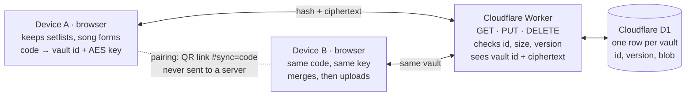

# Device sync — plan & WBS

As of 2026-11-13. Status: proposal, not started.

Not complex: the server is about 100 lines and one database table. The real work is merging edits from several devices and the UI around the sync code. Phase 1 (your own devices) is about 7½ days, an MVP about 6; phase 2 (sharing in a band) about 6 more. Sync is opt-in: by default everything stays in this browser only, exactly as today.

## How it works

The server only ever sees a hashed id and encrypted data; the two browsers are the only places the data is readable.

Each device turns the sync code into a vault id and an encryption key; the Worker stores whatever encrypted blob it is given under that id, refusing a write when another device has written since.

## Design decisions

Each choice keeps the server dumb and the browser in charge; local storage stays the source of truth, sync only copies it.

**Local first, sync only when asked.** Out of the box the site makes no sync request at all; local storage is the only copy.

1. **Connect devices** (first device): makes a sync code, encrypts the current local setlists and song forms, and uploads that first copy.
2. **Join with a code** (each further device): downloads, decrypts and merges with what that device already has, then uploads the merged result.
3. While connected: every local change is encrypted and uploaded a few seconds later; local storage stays the working copy, so the page never waits on the network.
4. **Disconnect this device**: stops syncing and forgets the code; local data stays. **Delete server copy** also removes the encrypted vault for every device.

An e2e test checks that no request goes to the sync host while sync is off.

Only the server copy is encrypted. Local storage on the device stays readable, as it is today: encrypting it locally would add little, because the code that unlocks it sits on the same device.

| Topic | Decision | Why |
| --- | --- | --- |
| Sync code | 128 random bits from `crypto.getRandomValues`, shown as 26 base32 characters plus a check character (`RJ7K-Q2MD-…`) | Unguessable like a password, readable aloud; works on Safari 12 |
| Server key | Vault id = SHA-256("rj-sync-id" + code) | The server never sees the code itself |
| Encryption | AES-GCM, key = SHA-256("rj-sync-key" + code), fresh 12-byte IV per write | Server and database hold only ciphertext; only `digest` + AES-GCM are used, both in Safari 11+ |
| Data synced | Personal setlists (`rj.setlists.v1`) and own song forms (`rj.songForm.<file>`) | Preferences stay per device in v1 (mixer levels, panel width differ by device) |
| Change tracking | Every setlist, setlist row and song form gets an id and an `updatedAt`; a delete leaves a tombstone, pruned after 180 days | Without tombstones a deleted setlist comes back from the other device; row ids prepare row-level merging for phase 2 |
| Format version | The synced data carries a format number; every app version keeps fields it doesn't know, and an app that sees a newer format only downloads, never uploads | The service worker keeps serving the previous app for a while after a deploy; an old copy must never strip newer data |
| Merge rule | Newest edit wins per setlist / per form, tie broken by device id | Simple and predictable; two people editing the same setlist at the same minute is rare |
| Database | Cloudflare D1, one table `vaults(id, version, blob, updated_at)` | Unlike Workers KV it can do "write only if version is still N", so two devices never overwrite each other blindly |
| Server API | `GET /v1/vault/:id`, `PUT /v1/vault/:id` with expected version (409 + current copy on conflict), `DELETE /v1/vault/:id`; 410 for a deleted vault | Three routes, no accounts, no sessions, no cookies |
| Deleted vaults | "Delete server copy" and "New code" leave a marker row; writes to that id get 410, and devices disconnect with "This sync was stopped or replaced" | Otherwise any device still holding the code uploads again and the vault comes back |
| Guards | CORS only for redjackets.nl and localhost:1313, id must be 64 hex, body ≤ 64 KB | A real library is a few KB; 64 KB is useless as file storage |
| Abuse limits | About 10 new vaults per IP per day, about 500 new vaults per day in total, vaults unused for 18 months deleted by a daily scheduled job (a device still connected just uploads again), admin delete by id; stay on the free plan | Encrypted data can't be checked, so the service is kept small, short-lived and worthless to abuse; on the free plan abuse means downtime, never a bill |
| Rate limit | Generous per IP: a band on one venue Wi-Fi shares one address | Must never block real members syncing at a gig |
| Pairing | Link `…/songs/#sync=<code>` shown as a QR code on screen; the phone camera opens it, and the code is removed from the address bar at once | Text after `#` never reaches a server; showing the QR rather than sending the link keeps the code out of chat histories |
| Offline | A dirty flag persists; sync retries on `online` and on page show | The site keeps working with no connection exactly as today |

This supersedes the earlier "Workers KV" idea: KV is eventually consistent and has no compare-and-swap, which would lose edits when two devices sync within a minute.

## Work breakdown

Phase 1 totals 7½ days, including the review fixes (deleted-vault marker, format version, row ids, abuse limits: WBS 2.3, 2.6, 4.4, 5.5). Packages marked MVP are the 6-day core.

| WBS | Work package | Deliverable | Est. (days) | MVP |
| --- | --- | --- | --- | --- |
| 1 | **Setup** | | **0.25** | |
| 1.1 | Cloudflare account, D1 database, API token as GitHub secret (you) | `CLOUDFLARE_API_TOKEN`, account id | 0.1 | yes |
| 1.2 | Hostname: `sync.redjackets.nl` if DNS can move to Cloudflare, else `*.workers.dev` | Reachable URL | 0.15 | yes |
| 2 | **Sync server** (`workers/sync/`) | | **1.5** | |
| 2.1 | Table schema and migration | `schema.sql` | 0.1 | yes |
| 2.2 | GET / PUT / DELETE handler with version check | `src/index.js` (~100 lines) | 0.3 | yes |
| 2.3 | Guards and abuse limits: CORS, id and 64 KB size checks, per-IP and global caps on new vaults, generous per-IP rate limit, daily job deleting vaults unused for 18 months | Guards + scheduled job | 0.45 | yes |
| 2.4 | Tests on Node's test runner with a fake D1 | `index.test.js` | 0.25 | yes |
| 2.5 | `wrangler.toml`, ESLint and jscpd cover `workers/**` | Config | 0.15 | yes |
| 2.6 | Deleted-vault marker: writes get 410; client disconnects with "This sync was stopped or replaced" | Server + client + tests | 0.25 | yes |
| 3 | **Code and crypto** (`lib/sync/crypto.js`) | | **0.5** | |
| 3.1 | Generate, format, parse and checksum the sync code | Functions + tests | 0.15 | yes |
| 3.2 | Vault id and key derivation | Functions + tests | 0.1 | yes |
| 3.3 | AES-GCM encrypt / decrypt envelope `{v, iv, ct}` | Functions + tests | 0.25 | yes |
| 4 | **Change tracking** | | **1.0** | |
| 4.1 | `setlists-store.js`: stamp `updatedAt` on every mutation, tombstone on delete | Store change + tests | 0.35 | yes |
| 4.2 | Song form: stamp `updatedAt`, tombstone on "back to the band's form" | `song-form.js` change + tests | 0.25 | yes |
| 4.3 | Migrate existing entries with no `updatedAt` | Migration + test | 0.15 | yes |
| 4.4 | Stable id per setlist row (prepares phase 2 row-level merging) | Store change + migration + tests | 0.25 | yes |
| 5 | **Merge** (`lib/sync/merge.js`) | | **1.0** | |
| 5.1 | Sync document model; build it from local storage | Functions | 0.2 | yes |
| 5.2 | Per-item newest-wins, tombstones, pruning | Functions | 0.25 | yes |
| 5.3 | Write merged result back to local storage | Functions | 0.1 | yes |
| 5.4 | Tests: merge is order-independent and repeatable; delete vs edit races | Tests | 0.2 | yes |
| 5.5 | Format version: keep unknown fields; download-only when the format is newer | Functions + tests | 0.25 | yes |
| 6 | **Sync engine** (`songs/sync/`) | | **1.0** | |
| 6.1 | `sync` slice in `core/state.js` (status, last synced, revision) and stored code | Slice + prefs | 0.15 | yes |
| 6.2 | Cycle: pull → merge → push with expected version; on 409 retry up to 3 times | Engine | 0.3 | yes |
| 6.3 | Triggers: after page load, 3 s after a local change, `online`, page shown again | Engine | 0.15 | yes |
| 6.4 | Setlist views redraw when a sync brings changes | Subscriptions | 0.15 | yes |
| 6.5 | Backoff, error states; jsdom tests with a stubbed `fetch` | Tests | 0.25 | yes |
| 7 | **UI** | | **1.0** | |
| 7.1 | "Connect devices" dialog, off by default: connect, join with a code, show code, disconnect this device, delete server copy, new code | Dialog | 0.4 | yes (plain) |
| 7.2 | Pairing link `#sync=` in `song-hash.js`: confirm, join, strip from URL | Deep link | 0.15 | |
| 7.3 | QR code (vendored `qrcode-generator`, MIT, ES5), with a hint to show it rather than send it | QR in dialog | 0.15 | |
| 7.4 | Status in the Yours shelf ("Synced 2 min ago", error) | Indicator | 0.15 | yes |
| 7.5 | CSS within the Safari-12 rules, accessibility (live region, focus) | Styles | 0.15 | |
| 8 | **Translations, tour, docs** | | **0.5** | |
| 8.1 | Strings in en / nl / de / fr, `npm run lint:i18n` clean | i18n toml | 0.2 | |
| 8.2 | Tour step in the Setlists chapter, four languages | Tour copy | 0.15 | |
| 8.3 | CLAUDE.md section; privacy page line on what is stored and that only the server copy is encrypted | Docs | 0.15 | |
| 9 | **CI / deploy** | | **0.25** | |
| 9.1 | `deploy-sync` job (`wrangler deploy`) on master when `workers/sync/**` changes | Workflow | 0.15 | yes |
| 9.2 | Post-deploy smoke check (GET of an unknown id returns 404) | Workflow step | 0.1 | |
| 10 | **Verification** | | **0.5** | |
| 10.1 | Playwright: two browser contexts, Worker mocked by route; an edit in one appears in the other; no sync request while sync is off | e2e test | 0.25 | |
| 10.2 | Real devices: old iPad (Safari 12) and a current phone | Checklist | 0.15 | yes |
| 10.3 | SonarCloud gate on the PR | Clean scan | 0.1 | yes |
| | **Total** | | **7.5** | **≈ 6** |

## Milestones

Five steps, each mergeable on its own, so nothing half-built reaches visitors.

1. **Server live** (WBS 1, 2, 9.1) — Worker deployed and tested, abuse limits on; no site change yet.
2. **Engine done, hidden** (WBS 3–6) — sync works end to end in tests; no button on the page.
3. **MVP on the site** (WBS 7.1, 7.4, 10.2, 10.3) — type a code on each device; plain dialog, English only.
4. **Full release** (WBS 7.2, 7.3, 7.5, 8, 9.2, 10.1) — QR pairing link, four languages, tour step, e2e test.
5. **Band sharing** (phase 2, WBS 11) — band space, named versions, shared setlists; once personal sync has been used for a while, if wanted.

The MVP leaves out the QR code and pairing link (codes are typed), translations and the tour step.

## Risks

The biggest risk is a lost or leaked code; everything else degrades to "works like today, without sync".

| Risk | Effect | Mitigation |
| --- | --- | --- |
| Sync code leaked (screenshot, link sent in a chat) | Whoever has it can read and change those setlists | "New code" moves the data to a fresh vault and marks the old one deleted; the dialog says to show the QR code rather than send it, and to treat the code like a password |
| Sync code lost on every device | Server copy unreadable for good | Local data is untouched; existing `.txt` export stays as the backup path |
| Deleted vault comes back from a device still holding the code | "Delete server copy" doesn't stick | Deleted-vault marker: writes get 410 and that device disconnects (WBS 2.6) |
| Older app copy (still served by the service worker after a deploy) syncs newer data | Fields it doesn't know are lost | Format version: unknown fields are kept, and a newer format is download-only (WBS 5.5) |
| Someone stores random data through the API | Database fills up, or is used as free file storage | 64 KB cap, per-IP and global caps on new vaults, 18-month expiry, admin delete; on the free plan abuse means downtime, never a bill |
| Band on one venue Wi-Fi hits the per-IP limit | Sync refused at a gig | Per-IP rate limit set generously; caps apply to creating vaults, not to syncing |
| Device clocks far apart | An older edit can win over a newer one | Acceptable for v1; could switch to a counter-based clock later if it bites |
| Two devices edit the same setlist at once | One device's edit to that setlist is lost | Rare for one person; phase 2 merges per row for shared setlists |
| Device offline for more than 180 days | Deleted setlists can come back from it | Accepted: tombstones are pruned after 180 days |
| Cloudflare down or blocked | No sync for a while | The page never waits on sync; retries later |
| Free-tier limits (D1: 100k writes/day) | Writes refused | Far above band use; writes are debounced to one per 3 s per device |
| Safari 12 gaps | Sync silently fails on the old iPad | Only `digest`, AES-GCM, `getRandomValues`, `fetch`; checked on the real device (WBS 10.2) |
| SonarCloud findings in new code | PR gate fails | Same lint layer covers `workers/**`; crypto randomness from `getRandomValues`, never `Math.random` |

## Phase 2: sharing in a band

A band joins one shared **band space** (its own code and vault); each member shares chosen song-form versions and setlists into it under a name they pick. About 6 days on top of phase 1; the Worker and table do not change.

**Two vaults per device, both optional.** The personal vault (phase 1) keeps private data in sync across your own devices. The band space holds only what you chose to share. A device can be in either, both or neither.

**Names, no accounts.** On joining a band space you type a display name ("Anna · clarinet"). The device also makes a random author id, so two people called Ben don't collide and a rename shows everywhere. A name is a label among bandmates, not a login: anyone holding the band code can type any name, which is fine inside a band.

**Song-form versions.** Each shared version is stored per song and per author, and only its author changes it (enforced by the app, not the server, like the names: fine among bandmates). That makes merging trivial: two people never write the same entry. The song-form menu then lists:

- The band's form (the `W:` table in the `.abc` file, still the official one)
- My version
- Anna's version, Pieter's version, … (read-only; "Copy to my version" to start from it)

A "Share with the band" switch per version decides whether it goes to the band space. A good version still reaches the official score the way it does today: copy its `W:` lines into the song file.

**Shared setlists.** "Share with the band" on a personal setlist moves it to the band space, listed under **Shared**, apart from the official **Band** setlists from the website. Every member can edit it, marked "edited by Anna". Merging happens per song row, using the row ids added in phase 1, so two people adding or moving different songs both keep their changes.

| WBS | Work package | Est. (days) |
| --- | --- | --- |
| 11.1 | Band space: join, leave, new code, display name and author id | 1.0 |
| 11.2 | Data model: versions per song per author; author-only writes | 0.75 |
| 11.3 | Song-form menu: others' versions, Copy to my version, Share switch | 0.75 |
| 11.4 | Shared setlists: share / unshare, row-level merge with ordering that survives concurrent moves, "edited by" | 2.0 |
| 11.5 | Moving items between the personal vault and the band space | 0.5 |
| 11.6 | Translations, tour step, e2e test with two members | 0.75 |
| 11.7 | "Band" vs "Shared" naming in the Setlists tab | 0.25 |
| | **Phase 2 total** | **6.0** |

Not covered: per-person rights (read-only members, removing one member without a new code). That needs a server-side write key per member; about 1 extra day if wanted.

## Decisions needed

Three answers unblock phase 1 (hostname, account, preferences); the rest can wait until phase 2.

- [ ] **Hostname:** is the redjackets.nl DNS on Cloudflare (then `sync.redjackets.nl`), or is a `workers.dev` address fine?
- [ ] **Cloudflare account:** who owns it, so the band keeps access if one person leaves?
- [ ] **Preferences:** keep them per device (proposed), or also sync instrument and comping choices?
- [ ] **Phase 2 order:** build band sharing right after phase 1, or first see how personal sync is used?
- [ ] **One band space or several?** One per device is simplest; several (e.g. a second band) adds a picker.
- [ ] **Names:** "Band" for the official setlists and "Shared" for band-space ones (proposed), or other words?
